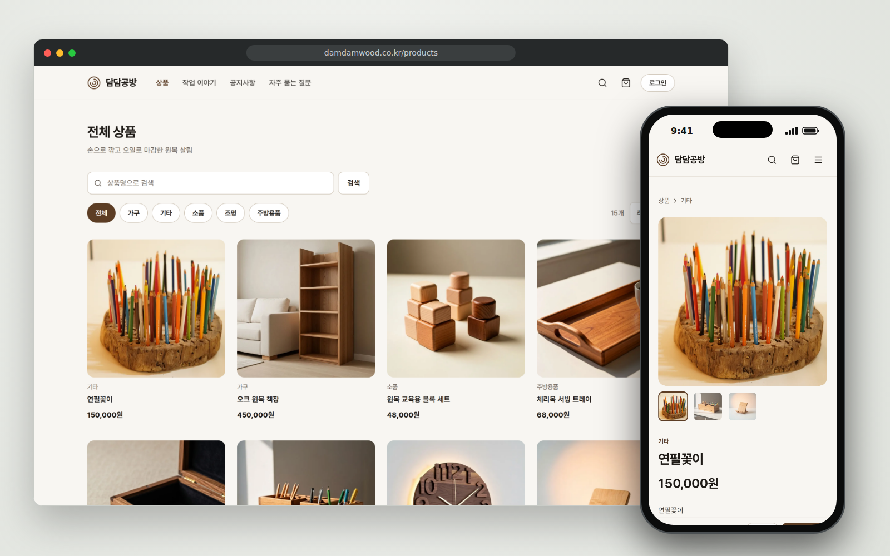
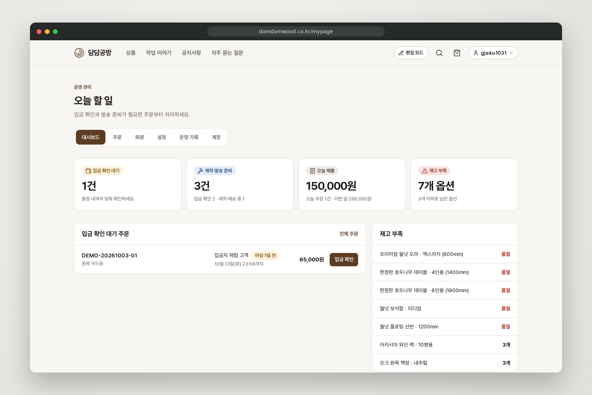
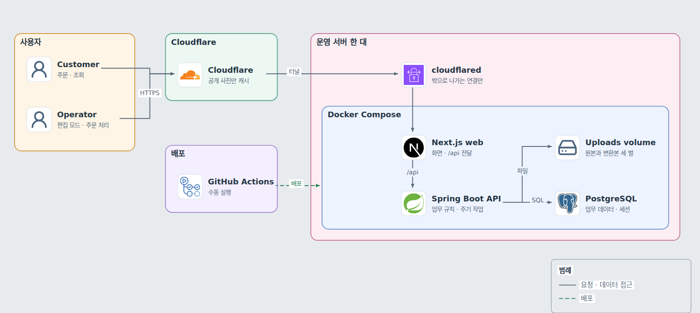

# damdam — 담담공방 쇼핑몰

수제 목공예품을 무통장 입금으로 파는 담담공방의 쇼핑몰. 재고가 한두 개뿐인 상품을 며칠 뒤에 입금받는 방식으로 팔면서 초과 판매와 묶인 재고가 생기지 않게 하는 것이 목표임. 외주로 개발해 운영 서버에 배포했고, 정식 오픈 전이라 실제 고객의 주문은 아직 없음.

- 프로젝트 문서: [블로그 대문](https://gjaku1031.github.io/ken-blog/post/project-a3d53a55-de01-4888-9e9a-02e34f2579bb/)
- 사이트: [damdamwood.co.kr](https://damdamwood.co.kr)
- 개발 형태: 외주 프로젝트, 2인 팀(프론트엔드 1명, 백엔드·인프라 1명)

## 주요 기능

| 기능 | 사용자가 할 수 있는 일 |
| --- | --- |
| 상품과 주문 | 고객이 상품을 장바구니에 담아 주문하고 계좌로 입금함. 결제 대기 주문은 직접 취소할 수 있음 |
| 입금 확인 | 운영자가 입금을 확인해 주문을 다음 상태로 넘김. 기한까지 입금이 없으면 주문이 자동으로 취소되고 재고가 돌아옴 |
| 재고 | 옵션별 수량을 조정하고 변동 이력을 봄 |
| 작업 이야기 | 운영자가 사진이 든 글을 쓰고, 초안을 자동 저장한 뒤 발행함. 회원은 댓글을 닮 |
| 편집 모드 | 운영자가 고객 화면에서 편집 모드를 켜 상품, 글, 공지, FAQ를 고침. 주문, 회원, 설정은 내 계정에서 다룸 |

## 화면

<picture>
  <source media="(prefers-color-scheme: dark)" srcset="docs/images/shop-dark.png">
  
</picture>

<picture>
  <source media="(prefers-color-scheme: dark)" srcset="docs/images/operator-dark.png">
  
</picture>

두 화면의 상품과 주문은 정식 오픈 전에 넣어 둔 예시 상품과 체험 데이터임.

## 핵심 문제와 결정

- **P1 재고 정합성**: 주문할 때 재고를 빼고, 옵션 행을 ID 순서로 잠근 뒤 수량을 확인함. 재고에는 DB의 `CHECK (stock >= 0)`을 걸었음. 입금 기한은 주문에 저장하고, 기한이 지난 결제 대기 주문은 5분마다 취소해 재고를 돌려놓음. 회원 한 명의 결제 대기 주문은 5건까지만 받음(`OrderService.java`, `SchedulerService.java`)
- **P2 사진 전송량**: 사진을 올릴 때 서버가 가로 400·800·1600px WebP 세 벌을 만들고, 브라우저가 화면 폭에 맞는 벌을 고름. 세 벌은 사진 키에 붙는 이름 규칙으로 찾아 스키마를 바꾸지 않음(`ImageConverter.java`, `StorageService.java`)
- **P3 개인 정보가 든 응답의 캐시**: CDN이 주소의 확장자만 보고 JSON 응답을 저장하지 않도록, API의 모든 응답에 `Cache-Control: no-store`를 기본으로 붙이고 누구에게나 같은 공개 사진만 캐시를 허용함(`NoStoreByDefaultFilter.java`)

검토한 대안과 대가, 검증은 [주요 기술적 의사결정](https://gjaku1031.github.io/ken-blog/post/doc-7a3c9e51-4b6d-4f82-a1e7-2d5c8b0f6e94/)에 있음.

## 아키텍처

<picture>
  <source media="(prefers-color-scheme: dark)" srcset="docs/images/architecture-dark.png">
  
</picture>

- 방문자의 요청은 Cloudflare를 거쳐 서버의 터널 프로세스(cloudflared)로 들어오고, 웹(Next.js)이 `/api` 요청을 API로 넘김. API 컨테이너는 서버 밖으로 포트를 열지 않음
- 업무 데이터와 로그인 세션은 PostgreSQL에, 사진의 원본과 변환본은 업로드 볼륨에 둠. 기한이 지난 주문의 자동 취소 같은 주기 작업은 API 프로세스 안에서 돎
- 배포는 워크플로를 수동으로 실행해 코드를 서버에 전달하고, 서버에서 이미지를 빌드해 컨테이너를 바꿈. 스키마는 API가 시작할 때 Flyway가 적용함

구성 요소와 일관성 보장 범위는 [아키텍처](https://gjaku1031.github.io/ken-blog/post/doc-2f8b6c4d-9a1e-4d73-b5c0-7e3a9d1f4b62/)에 있음.

## 기술 스택

| 영역 | 기술 |
| --- | --- |
| 웹 | Next.js 16, React 19, TypeScript |
| API | Spring Boot 4, Java 25, JPA와 jOOQ, Flyway |
| DB | PostgreSQL 16(업무 데이터와 로그인 세션) |
| 배포 | 서버 한 대의 Docker Compose, Cloudflare Tunnel과 CDN, GitHub Actions |

## 문서

- 블로그 문서: [아키텍처](https://gjaku1031.github.io/ken-blog/post/doc-2f8b6c4d-9a1e-4d73-b5c0-7e3a9d1f4b62/), [기능과 사용자 흐름](https://gjaku1031.github.io/ken-blog/post/doc-c5e7a1b9-3d2f-4a86-9c4e-1b8d6f0a3e75/), [데이터 모델과 ERD](https://gjaku1031.github.io/ken-blog/post/doc-9d4a2e6f-7c1b-4e59-a3d8-5f0b2c7e9a14/), [API 설계](https://gjaku1031.github.io/ken-blog/post/doc-ff4d275c-469e-4c6b-ae8a-94b71f12f46b/), [주요 기술적 의사결정](https://gjaku1031.github.io/ken-blog/post/doc-7a3c9e51-4b6d-4f82-a1e7-2d5c8b0f6e94/), [배포와 운영](https://gjaku1031.github.io/ken-blog/post/doc-e1b3f5a7-6c8d-4b20-8f9a-4d2e6c0b7a39/), [보안 설계](https://gjaku1031.github.io/ken-blog/post/doc-6a9c1e3b-5d7f-4c42-b0e8-3a5d7f9b1c86/)
- 문제별 글: [입금 안 된 주문이 재고를 놓지 않던 쇼핑몰](https://gjaku1031.github.io/ken-blog/post/post-5d0f6c1e-7b3a-4c58-9e21-3f6a1d2b8c47/), [목록이 원본 사진을 통째로 받고 있던 쇼핑몰](https://gjaku1031.github.io/ken-blog/post/post-8c2e4a97-1d5b-4f36-a0c9-6b7e2f4d1a83/), [사진 404를 쫓다가 찾은 CDN 캐시 구멍](https://gjaku1031.github.io/ken-blog/post/post-b4f19d3c-62a8-4e7d-95b1-0c8a7e3f5d26/)
- 저장소의 설계 기록: [재고](docs/inventory-tradeoffs.md), [사진 변환](docs/image-optimization-tradeoffs.md), [응답 캐시](docs/response-cache-tradeoffs.md)
- 운영과 규칙: [서버 운영](docs/server-deploy.md), [CI/CD](docs/cicd.md), [Cloudflare Tunnel](docs/cloudflare-tunnel.md), [운영 안내](docs/blog-operations.md), [코드 컨벤션](docs/convention/CODE.md), [주석 컨벤션](docs/convention/COMMENTS.md)

## 담당 범위

백엔드와 인프라를 맡았음. 의뢰인과의 소통, 백엔드 API와 DB 스키마, 서버 구성과 배포 절차, 재고·사진 변환·응답 캐시의 설계 결정이 여기에 들어감. 상세는 [블로그 대문](https://gjaku1031.github.io/ken-blog/post/project-a3d53a55-de01-4888-9e9a-02e34f2579bb/)에 있음.
